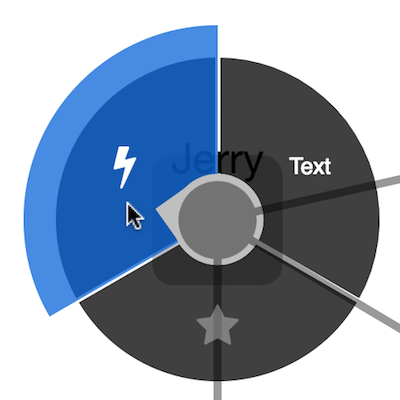

cytoscape-cxtmenu
================================================================================

[](https://zenodo.org/badge/latestdoi/16010906)



## Description

A circular, swipeable context menu extension for Cytoscape.js 
- Demo with default options: [demo](https://cytoscape.github.io/cytoscape.js-cxtmenu)
- Demo with adaptative spotlight radius features: [demo](https://cytoscape.github.io/cytoscape.js-cxtmenu/demo-adaptative.html) 
- Demo with `outsideMenuCancel`: [demo](https://cytoscape.github.io/cytoscape.js-cxtmenu/demo-cancel-outside.html) 

This extension creates a widget that lets the user operate circular context menus on nodes in Cytoscape.js.  The user swipes along the circular menu to select a menu item and perform a command on either a node, a edge, or the graph background.

## Dependencies

 * Cytoscape.js ^3.2.0


## Usage instructions

Download the library:
 * via npm: `npm install cytoscape-cxtmenu`,
 * via bower: `bower install cytoscape-cxtmenu`, or
 * via direct download in the repository (probably from a tag).

Import the library as appropriate for your project:

ES import:

```js
import cytoscape from 'cytoscape';
import cxtmenu from 'cytoscape-cxtmenu';

cytoscape.use( cxtmenu );
```

CommonJS require:

```js
let cytoscape = require('cytoscape');
let cxtmenu = require('cytoscape-cxtmenu');

cytoscape.use( cxtmenu ); // register extension
```

AMD:

```js
require(['cytoscape', 'cytoscape-cxtmenu'], function( cytoscape, cxtmenu ){
  cxtmenu( cytoscape ); // register extension
});
```

Plain HTML/JS has the extension registered for you automatically, because no `require()` is needed.


## CSS

You can style the font of the command text with the `cxtmenu-content` class, and you can style disabled entries with the `cxtmenu-disabled` class.


## API

You initialise the plugin on the same HTML DOM element container used for Cytoscape.js:

```js

let cy = cytoscape({
	container: document.getElementById('cy'),
	/* ... */
});

// the default values of each option are outlined below:
let defaults = {
  menuRadius: function(ele){ return 100; }, // the outer radius (node center to the end of the menu) in pixels. It is added to the rendered size of the node. Can either be a number or function as in the example.
  selector: 'node', // elements matching this Cytoscape.js selector will trigger cxtmenus
  commands: [ // an array of commands to list in the menu or a function that returns the array (may also return a promise of the array)
    /*
    { // example command; all options shown
      content: 'a command name', // html/text content to be displayed in the menu (string or HTMLElement)
      contentStyle: {}, // css key:value pairs to set the command's css in js if you want
      fillColor: 'rgba(200, 200, 200, 0.75)', // optional: custom background color for item; defaults to the menu-level `fillColor`
      select: function(ele, gestureStartEvent){ // a function to execute when the command is selected
        console.log( ele.id() ) // `ele` holds the reference to the active element; `gestureStartEvent` is the event that opened the menu
      },
      hover: function(ele, gestureStartEvent){ // optional: a function to execute when the command is hovered
        console.log( ele.id() )
      },
      enabled: true, // whether the command is selectable; false renders it with the `cxtmenu-disabled` class
      disabled: false, // alternative flag: true also disables the command (either works)
      subcommands: [] // optional: nested commands (same shape as this one) opened as an additional concentric ring; each may nest further via its own `subcommands`; omit for a plain command
    }
    */
  ], // function( ele ){ return [ ... ] }, // a function that returns commands or a promise of commands
  fillColor: 'rgba(0, 0, 0, 0.75)', // the background colour of the menu
  activeFillColor: 'rgba(1, 105, 217, 0.75)', // the colour used to indicate the selected command
  activePadding: 20, // additional size in pixels for the active command
  indicatorSize: 24, // the size in pixels of the pointer to the active command, will default to the node size if the node size is smaller than the indicator size, 
  separatorWidth: 3, // the empty spacing in pixels between successive commands
  spotlightPadding: 4, // extra spacing in pixels between the element and the spotlight
  adaptativeNodeSpotlightRadius: false, // specify whether the spotlight radius should adapt to the node size
  minSpotlightRadius: 24, // the minimum radius in pixels of the spotlight (ignored for the node if adaptativeNodeSpotlightRadius is enabled but still used for the edge & background)
  maxSpotlightRadius: 38, // the maximum radius in pixels of the spotlight (ignored for the node if adaptativeNodeSpotlightRadius is enabled but still used for the edge & background)
  openMenuEvents: 'cxttapstart taphold', // space-separated cytoscape events that will open the menu; only `cxttapstart` and/or `taphold` work here
  itemColor: 'white', // the colour of text in the command's content
  itemTextShadowColor: 'transparent', // the text shadow colour of the command's content
  zIndex: 9999, // the z-index of the ui div
  atMouse: false, // draw menu at mouse position
  outsideMenuCancel: false, // if set to a number, this will cancel the command if the pointer is released outside of the spotlight, padded by the number given 
  submenuDefaults: { // defaults for all submenu rings
    pinning: false, // true: resting the pointer freezes the whole menu — the pointer may disengage (mouseup / finger off) and the menu stays as-is while panning/zooming/node-dragging remain possible (the menu follows its node); re-engaging anywhere on the frozen menu (taphold / clickhold) starts a `pinDelay` release countdown after which the menu reacts normally again; moving while engaged releases immediately
    pinDelay: 500, // freeze countdown in ms once the pointer has been still, and release countdown on re-engage (a loading-circle indicator with a lock icon on the center node visualizes both)
    stillDelay: 300, // the pointer must rest at one location for this many ms before the freeze countdown (and its indicator) starts; any movement restarts it
    ringWidth: 300, // radial width in pixels of each submenu ring (number or function(ele)); false defaults to menuRadius
    segmentThreshold: 6 // submenus with fewer commands than this render as a ring segment next to their owner command instead of a full ring; 0 disables segments
  }
};

let menu = cy.cxtmenu( defaults );
```

You get access to the cxtmenu API as the returned value of calling the extension.  You can use this to clean up and destroy the menu instance:

```js
let menu = cy.cxtmenu( someOptions );

menu.destroy();
```

## Submenus

Commands may declare nested commands via `subcommands: [ /* commands */ ]`.  A submenu opens as the next concentric ring around the active element while the owner command is highlighted; deeper submenus continue outward.  The visible rings always form one hierarchical chain (root → submenu → sub-submenu …); moving to a different command replaces the outward rings.  Commands without `subcommands` behave exactly as before, so existing menus are unaffected.

All submenu behaviour is configured through the `submenuDefaults` object (partial overrides merge with the defaults):

* `pinning: true` enables freezing: once the pointer has rested at one location for `stillDelay` ms, a freeze countdown of `pinDelay` ms runs; when it completes, the whole menu freezes.  The pointer may then disengage (mouse button up / finger off) and the menu stays exactly as it is.  While parked, canvas gestures stay live — the graph can be panned and zoomed and the node dragged; the menu follows its node.  Re-engaging anywhere on the frozen menu (taphold / clickhold) starts a `pinDelay` release countdown; when it completes — or as soon as the engaged pointer moves — the menu reacts normally again.  A small loading-circle indicator with a lock icon on the center node visualizes both countdowns (it fills clockwise from 12 o'clock towards freezing and unwinds during release); it only appears once the pointer has been still for `stillDelay` ms.
* `ringWidth` sets the radial width of each ring (number or `function(ele)`; `false` falls back to `menuRadius`).
* Submenus with fewer commands than `segmentThreshold` (default 6) render as a ring segment centered on their owner command instead of a full circle, each sector spanning `360° / segmentThreshold` (`0` disables segments and always uses full rings).


## Build targets

* `npm run test` : Run the node test suite in `./test`
* `npm run test:min` / `npm run test:latest` : Run the tests against the minimum / latest supported Cytoscape.js version
* `npm run build` : Build `./src/**` into `cytoscape-cxtmenu.js`
* `npm run watch` : Automatically build on changes with live reloading (N.b. you must already have an HTTP server running)
* `npm run dev` : Automatically build on changes with live reloading with webpack dev server
* `npm run lint` : Run eslint on the source

N.b. all builds use babel, so modern ES features can be used in the `src`.


## Publishing instructions

This project is set up to automatically be published to npm and bower.  To publish:

1. Build the extension : `npm run build:release`
1. Commit the build : `git commit -am "Build for release"`
1. Bump the version number and tag: `npm version major|minor|patch`
1. Push to origin: `git push && git push --tags`
1. Publish to npm: `npm publish .`
1. If publishing to bower for the first time, you'll need to run `bower register cytoscape-cxtmenu https://github.com/cytoscape/cytoscape.js-cxtmenu.git`
1. [Make a new release](https://github.com/cytoscape/cytoscape.js-cxtmenu/releases/new) for Zenodo.
